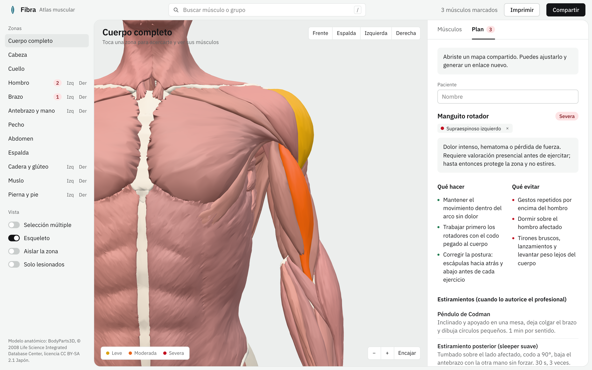
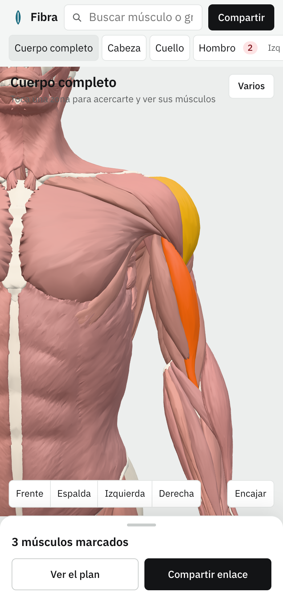

# Fibra, atlas muscular 3D

Herramienta para fisioterapia: un visor 3D del cuerpo humano, con todos sus músculos, para marcar los lesionados y obtener su pauta de qué hacer, qué evitar, estiramientos y ejercicios.

**Pruébalo: https://israads.github.io/fibra-atlas-muscular/** (funciona en el celular, sin instalar nada y sin crear cuenta)

<p align="center">
  
  
</p>

## Para quién es

- **Fisioterapeutas**: en consulta, giras el cuerpo, tocas los músculos afectados y le enseñas al paciente la línea completa que le duele. Asignas la gravedad (leve, moderada o severa) y le mandas un enlace con su mapa y su plan.
- **Pacientes**: abres el enlace que te mandó tu fisio y ves exactamente qué músculos son, dónde están, qué debes hacer y qué debes evitar.
- **Estudiantes de fisioterapia y anatomía**: 403 músculos con su nombre en español, su grupo y su acción. Puedes ocultar los superficiales para ver los profundos y aislar una zona.

No se guarda nada en ningún servidor: el mapa viaja dentro del propio enlace.

## Uso

```bash
npm install
npm run dev      # abre http://127.0.0.1:5173
npm run build    # genera dist/ (sitio estático)
```

- Clic en una zona del cuerpo: acerca la cámara a esa zona. Clic en un músculo: lo selecciona.
- Arrastrar gira, la rueda acerca, arrastrar con el botón derecho desplaza.
- Clic derecho, doble clic o pulsación larga (táctil) sobre un músculo: menú para asignar la gravedad.
- Selección múltiple (o Mayús + clic) para formar un grupo de músculos y marcarlos juntos.
- Teclas: `1` leve, `2` moderada, `3` severa, `0` sano, `H` ocultar el músculo (para ver los profundos), `Esc` volver, `/` buscar.
- Las marcas, el nombre del paciente y las notas se guardan en el navegador (localStorage).

## Publicación

Sitio: https://israads.github.io/fibra-atlas-muscular/

`npm run deploy` compila y sube `dist/` a la rama `gh-pages`, que es la que sirve GitHub Pages.

## Compartir

El botón Compartir genera un enlace que lleva en la URL los músculos marcados, su gravedad, el nombre y las notas. No hay servidor ni cuentas: quien abre el enlace ve el mismo mapa y su plan.

## Estructura

- `src/viewer.js`: escena three.js, cámara, selección.
- `src/main.js`: interfaz, estado, plan.
- `src/muscles.js`: nombre en español, grupo y acción de cada músculo.
- `src/groups.js`: contenido clínico por grupo (qué hacer, qué evitar, estiramientos, ejercicios).
- `tools/build-model.mjs`: regenera `public/model/body.glb` a partir de los STL de BodyParts3D (`npm run model -- <carpeta-stl>`).

## Créditos y licencia del modelo

Modelo anatómico: BodyParts3D, © 2008 Life Science Integrated Database Center, licencia CC BY-SA 2.1 Japón. El archivo `public/model/body.glb` es una obra derivada (simplificada y comprimida) y se distribuye bajo la misma licencia.

El contenido clínico es orientación general y no sustituye la valoración de un profesional.
